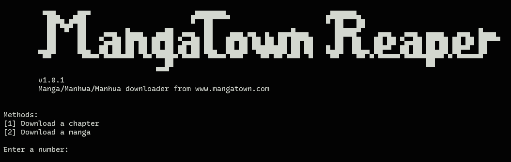
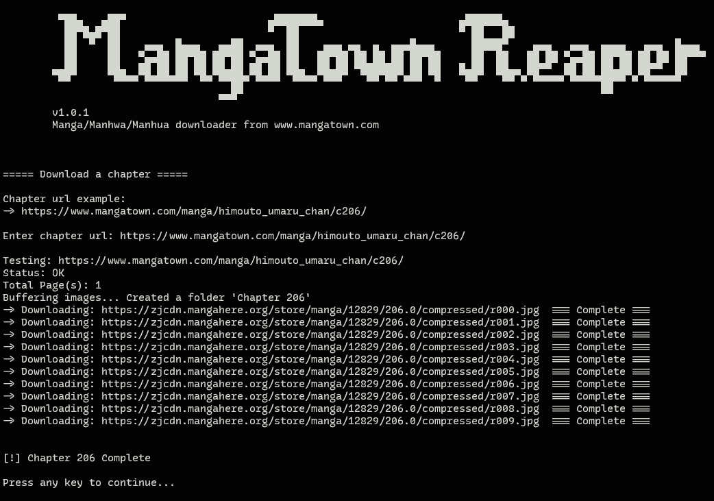

MangaTown Reaper

<p align="center">
  
</p>

A Python-based manga, manhwa, and manhua downloader for MangaTown. Download individual chapters or entire series, with each page saved as a numbered image in its own folder.

---

## Features
- **Chapter Downloading:** Download all pages from a specific chapter.
- **Full-Series Downloading:** Automatically download chapters across an entire series.
- **Automatic Organization:** Save downloaded pages as numbered images in chapter-specific folders.
- **Simple CLI:** Navigate through an interactive command-line interface.

## Installation
> [!IMPORTANT]
> Open a PowerShell terminal before proceeding.

**1. Clone the Repository**
```bash
git clone https://github.com/kenetsevilla/mangatown-reaper.git
cd mangatown-reaper
```
<br>

**2. Create a Virtual Environment**
```powershell
python -m venv myvenv
```
**3. Activate the environment**
```powershell
.\myvenv\Scripts\Activate.ps1
```
<br>

**4. Install Dependencies**
```powershell
pip install -r requirements.txt
```
Dependencies:
- requests
- beautifulsoup4
<br>

**5. Run the Application**
```powershell
python .\mangatown_reaper.py
```
<br>

## Example Output
<p align="center">
  
</p>

## Requirements
- Python
- Windows
- An internet connection
> [!NOTE]
> This project relies on MangaTown's website structure. Changes to the website may affect functionality.

> [!WARNING]
> ``Disclaimer`` <br>
> This project is intended for educational purposes. Please respect copyright laws and the website's terms of service when downloading content.
